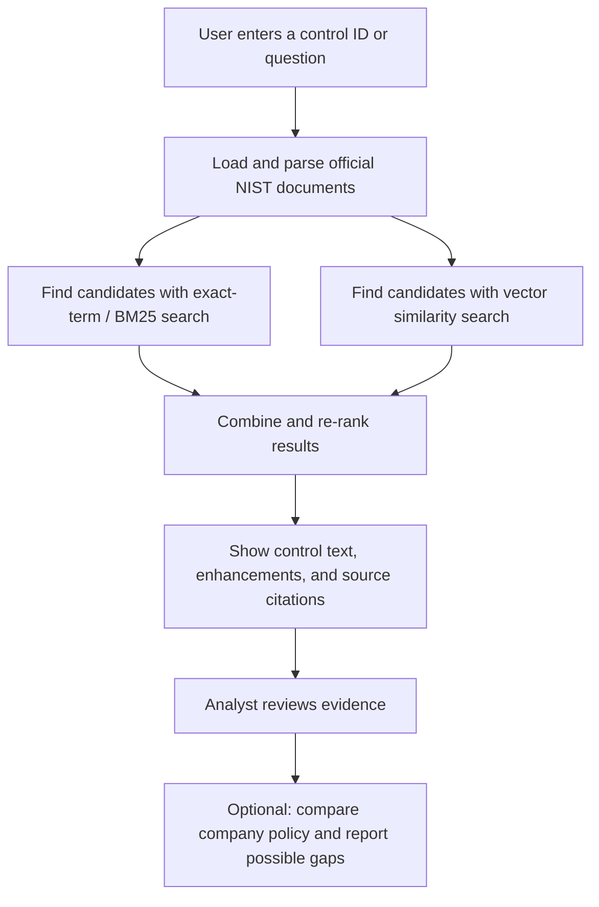

# ControlMap 🛡️
### Find exact NIST cybersecurity controls faster

ControlMap is a cybersecurity compliance search tool for auditors and security analysts. Search for a control ID such as `AC-2(4)` or `IA-5(1)` and, as the project develops, get the matching NIST control text, enhancements, related controls, and source references in one place.

[](https://github.com/Vignesh7778/sample/actions/workflows/ci.yml)

**Live:** https://controlmap.onrender.com/health · first request after 15 idle minutes takes about a minute (free tier)

> **Project status:** Starter backend created. Exact-control search, document ingestion, hybrid retrieval, and policy gap analysis are planned features—not yet represented as completed functionality in this repository.

## Problem

Security auditors and Governance, Risk, and Compliance (GRC) analysts regularly need to look up exact requirements in long NIST cybersecurity publications. Searching thousands of pages manually takes time, and ordinary meaning-based search may return related passages instead of the exact control ID or enhancement an auditor needs. ControlMap aims to make this work faster by searching the official text using both exact control identifiers and natural-language meaning. The longer-term goal is to help analysts compare company security policies with NIST requirements and review possible gaps using cited source text.

## Who it is for

- **GRC analyst or security auditor at a fintech company in Chennai** preparing for a security audit.
- **Security and compliance teams** that need to look up NIST control requirements and support policy reviews.

## Signature feature

**Control ID jump:** enter an identifier such as `IA-5(1)` and retrieve its exact control text, applicable enhancements, related controls, and citations to the official NIST source—once the search feature has been implemented.

## How it works

The intended search and review flow is:



**In plain language:**
1. Collect public NIST publications and preserve document titles, headings, control IDs, and page numbers.
2. Split documents into searchable passages.
3. Search exact IDs with keyword ranking (BM25), and search natural-language questions with vector similarity.
4. Combine and re-rank the matches.
5. Present the relevant passage and citation so the analyst can verify the answer.
6. For policy analysis, suggest control mappings and possible gaps; a human reviewer must verify the evidence before using the report in an audit.

## Main features planned

- **Exact ID search:** look up IDs such as `AC-2(4)`, `SC-7`, and `IA-5(1)`.
- **Hybrid search:** combine keyword matching with meaning-based vector search.
- **Re-ranking:** move the most relevant passages higher in the result list.
- **Evidence and citations:** show the source publication and page or section for each answer.
- **Policy gap analysis:** suggest mappings from a company policy to NIST controls, with evidence for human review.
- **Evaluation:** measure exact-hit rate against a set of 50 questions with verified expected control IDs. The project target is **90% or higher**; this is a target, not a measured result yet.

## Hardest problem (my interview story)

The hardest technical problem is retrieving the **exact** control and enhancement, not just a passage that sounds similar. A semantic search system can miss identifiers such as `AC-2(4)`, while keyword search alone may struggle with a question written in everyday language. ControlMap will address this by combining exact-term/BM25 search with vector search, re-ranking the candidates, and evaluating the results against a labelled test set of 50 control-ID questions. Each answer must include source evidence, and a GRC analyst should review policy-gap findings before they are used for an audit.

## Dataset

Start with public NIST Special Publications from the official NIST Computer Security Resource Center. Record the exact documents downloaded, publication versions, page counts, download dates, and applicable terms in `DATASET.md`.

| Source | Link | Documents | Pages | Licence / terms |
|---|---|---:|---:|---|
| NIST Special Publications (SP 800 series) | [Official NIST publications page](https://csrc.nist.gov/publications/sp800) | To be recorded in `DATASET.md` | Count after download and parsing | Check the terms on each source publication; NIST-authored publications are generally public information, but verify any third-party material included. |

**Dataset note:** The project brief calls for **3,000+ pages** eventually. Do not report that total as collected until you have downloaded the documents and verified the page count. Keep the full raw dataset outside Git if it is large; commit only a small sample when appropriate.

## Example questions

The evaluation set should include questions such as:

1. What does control `AC-2(4)` require?
2. What does `IA-5(1)` cover?
3. What does control `SC-7` address?
4. Which enhancements belong to a specified control?
5. Which controls are related to `AC-2`?
6. What does NIST SP 800-61 say about incident containment?
7. Which phase or activity covers containment in the selected edition of SP 800-61?
8. What password guidance does NIST SP 800-63B provide in the selected edition?
9. Which NIST control best matches a specified section of a sample company policy, and what source passage supports the mapping?
10. A question the collected documents **cannot answer** (the correct behavior should be to say the source set does not contain enough evidence).

For each question, fill in the source document, page/section, whether multiple pages are needed, and the expected control ID in [`docs/QUESTIONS.md`](docs/QUESTIONS.md). Confirm answers against the specific publication edition you collect.

## Technology stack

- **Python** — application logic
- **FastAPI** — backend API
- **BM25 / keyword search** — exact IDs and terms
- **Vector embeddings** — meaning-based retrieval
- **PostgreSQL + pgvector** — planned storage and vector search
- **RAG / LLM** — planned evidence-grounded answers, with citations
- **NIST Special Publications** — source knowledge base

## Current API

The starter app currently includes a health-check endpoint:

- `GET /health` — confirms that the API process is running.

The planned endpoints (such as `POST /ask` and policy analysis) are not documented as available until they are implemented and tested.

## Run locally

### Windows PowerShell

```powershell
py -m venv .venv
.\.venv\Scripts\Activate.ps1
python -m pip install --upgrade pip
pip install -r requirements-dev.txt
Copy-Item .env.example .env
python -m uvicorn app.main:app --reload
```

If PowerShell blocks virtual-environment activation, use Command Prompt instead:

```bat
.venv\Scripts\activate.bat
```

### macOS / Linux

```bash
python3 -m venv .venv
source .venv/bin/activate
python -m pip install --upgrade pip
pip install -r requirements-dev.txt
cp .env.example .env
uvicorn app.main:app --reload
```

Open `http://127.0.0.1:8000/health` in your browser, or run:

```bash
curl http://127.0.0.1:8000/health
```

## Run with Docker
```bash
cp .env.example .env
docker compose up --build
curl localhost:8000/ready
```

Expected response is a JSON object with `"status": "ok"`. The `requirements-dev.txt` file is used by the current starter instructions; check that it exists in your checkout before installing.

## Evaluation

Create 50 labelled questions that include exact control IDs and enhancements. Measure:

- **Exact-hit rate:** percentage of questions for which the correct control ID appears in the top result (or define a different rank cutoff explicitly).
- **Citation correctness:** whether the source document and page/section actually support the answer.
- **Unsupported-question handling:** whether the system clearly says when the collected sources do not contain the answer.

**Target:** 90%+ exact-hit rate on the 50-question test set. Do not present this target as achieved accuracy until it has been measured.

## Roadmap

- [ ] Complete the project description and dataset inventory.
- [ ] Collect the first NIST documents and record verified page counts.
- [ ] Build exact control-ID lookup.
- [ ] Add BM25 + vector hybrid retrieval and re-ranking.
- [ ] Add citation-grounded question answering.
- [ ] Evaluate against 50 labelled questions.
- [ ] Add policy-to-control mapping with human review.
- [ ] Deploy the application and add the live URL.

## Project links

- **Repository:** [Vignesh7778/ControlMap](https://github.com/Vignesh7778/ControlMap)
- **NIST SP 800 publications:** https://csrc.nist.gov/publications/sp800
- **Live link:** https://controlmap.onrender.com